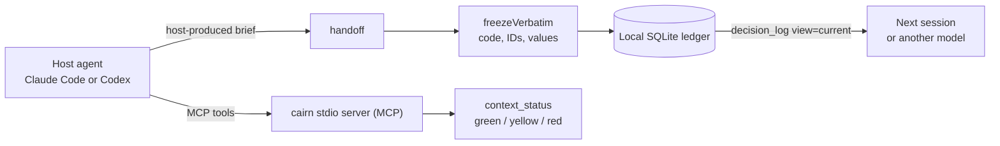

<div align="center">

# 🪨 Cairn

### AI Context Continuity Engine

**A local-private context-handoff tool for long agent sessions.**
Cairn warns you about context rot, preserves decisions + evidence, and hands a
faithful 7-bucket brief to the next session, or the next model.

<br/>

<kbd>MCP stdio</kbd> · <kbd>SQLite Ledger</kbd> · <kbd>Account Mode</kbd> · <kbd>Claude Code</kbd> · <kbd>Codex</kbd> · <kbd>No Telemetry</kbd> · <kbd>Node ≥ 22</kbd>

<br/>

`Cairn resume` &nbsp;·&nbsp; `Cairn Handoff` &nbsp;·&nbsp; `Cairn Help`

**v1.4.0** · MIT License

</div>

---

## ✨ The Problem

Long AI sessions lose first the things that are most expensive to miss later:
architecture decisions, rationale, discarded paths, exact IDs, code and config blocks.
Cairn keeps a local memory **alongside** the agents for exactly this: no backend, no cloud.

| Without Cairn | With Cairn |
|---|---|
| 🌫️ Context fills up, quality degrades unnoticed | 🟢🟡🔴 Zone indicator relative to the active window |
| 🧹 Host compaction loses detail | 📋 7-bucket brief: decisions, evidence, constraints |
| ✂️ Code/IDs get paraphrased | 🔒 Verbatim freeze, byte-exact restoration |
| 🔌 Switching between sessions/models is brittle | 🗄️ Persistent decision/evidence ledger |
| 🕵️ Internal work should stay local | 🏠 stdio + SQLite, no telemetry, no egress |

---

## 🧭 How It All Fits Together



The default path is **account mode**: the host agent writes the handoff brief inside your running
Claude or Codex session. Cairn only **stores and validates** it: **no** server-side
model call, **no** API keys, **no** egress through Cairn. If your session model is not the most faithful
summarizer (Claude Opus 5.5 on Claude, GPT-6.1 Sol on Codex), the handoff result says so, and you can
switch the model (`/model`) and run Cairn Handoff again. Cairn never does that on its own: re-compacting
the session would be a second model call over the whole context.

---

## ⚡ In 30 Seconds

```bash
git clone <repo-url> cairn
cd cairn
npm install
node dist/server.js install      # detects Claude Code + Codex, wires up both best-effort
```

Cairn acts **only when you explicitly ask**. It does not resume/save at task or session boundaries,
on yellow/red zones, or around compaction. One request covers one action; resume never enables
a later automatic handoff. Help and passive status displays do not call MCP tools.

Then just say it in chat (or use `/cairn-handoff`, `/cairn-resume`, `/cairn-help` in Claude Code;
`$cairn-handoff`, `$cairn-resume`, `$cairn-help` in Codex):

| Say… | …and the agent does |
|---|---|
| **`Cairn resume`** | Re-inject the ledger (`decision_log view=current`) and continue from it as the source of truth, **without** re-reading the repo |
| **`Cairn Handoff`** | Author a 7-bucket brief from the conversation and persist it to the ledger |
| **`Cairn Help`** | A short reference table of all triggers, tools, and shell commands |

To undo: `node dist/server.js uninstall`

---

## 🧱 Core Principles

| Principle | Meaning |
|---|---|
| **MCP core, no browser capture** | The conversation comes from the host agent: no DOM scraping, no UI adapters. |
| **Fidelity over cost** | Fidelity is primary; cost is only a tiebreaker between equally faithful candidates. |
| **Surface-relative zones** | Percentages against `min(model_max, surface_cap, user_override)`, never against the model maximum. |
| **Respect the host ecosystem** | Only what the active host session can reach is chosen for live use. |
| **Verbatim over poor compression** | Below the fidelity floor, Cairn would rather deliver complete than short and wrong. |
| **Local-private by default** | SQLite file, stdio process, no telemetry, no credentials in standard operation. |

> The binding architecture is documented in [docs/adr/ADR-cairn.md](docs/adr/ADR-cairn.md).

---

## 🛠️ The Four MCP Tools

| Tool | Job | Typical moment |
|---|---|---|
| `host_status` | Detects installed host CLIs, login (best-effort), and the active model. | Explicit host-status request |
| `decision_log` | Re-injects accepted + open decisions from the ledger. | Explicit Cairn resume request |
| `context_status` | Computes the zone relative to the active window. | Explicit context-status request |
| `handoff` | Persists the host-produced 7-bucket brief with verbatim protection. | Explicit Cairn Handoff request |

The zones are deliberately simple:

| Zone | Threshold | Meaning |
|:--:|:--:|---|
| 🟢 **Green** | `< 40 %` | Keep working normally |
| 🟡 **Yellow** | `40–70 %` | Context filling; user decides whether to request a handoff |
| 🔴 **Red** | `≥ 70 %` | High context usage; no automatic handoff |

---

## 📋 The 7-Bucket Brief

Every handoff follows the same format:

```text
DECISIONS · EVIDENCE · OPEN QUESTIONS · CONSTRAINTS · VERBATIM · NEXT STEPS · DISCARDED
```

Mandatory values, IDs, paths, code fences, and inline code are passed as `requiredVerbatim` / `exactSpans`.
Cairn masks them with `[[CAIRN-HOLD-n]]` before any optional condensation and restores them
afterward **byte-exact**. A new handoff **supersedes the previous one**, so the ledger stays lean
and `decision_log view=current` carries only the most recent brief.

---

## 🖥️ Codex Ambient Zone & Shell Commands

Codex has no statusline API. Cairn reads the local rollout files **read-only** and shows the
zone ambiently, in the terminal or window title:

```bash
cairn status      # one line, e.g.  🟢 21% ctx · gpt-5.5
cairn window      # live zone strip as a second pane (Windows Terminal / tmux / iTerm2)
cairn tab         # zone in the terminal/tab title · 'cairn stop' ends it
cairn list        # most recently active Codex sessions (pin with --session <uuid>)
```

Details and tmux/zellij snippets: [integration/codex/ambient-zone.md](integration/codex/ambient-zone.md).

---

## 📦 Installation

<details open>
<summary><b>Path A: Self-installer (recommended)</b></summary>

<br/>

Detects Claude Code and Codex best-effort and installs only what makes sense on your system.
Existing configuration is **augmented** via marked blocks or merged JSON sections, no
foreign project files are rewritten.

```bash
npm install
node dist/server.js install
```

</details>

<details>
<summary><b>Path B: Claude Code plugin</b></summary>

<br/>

```text
/plugin marketplace add /ABSOLUTE/PATH/cairn
/plugin install cairn@cairn
```

The plugin ships the MCP server and explicitly invoked skills, with no automatic hooks. For the full statusline, the
self-installer is still the easiest path.

</details>

<details>
<summary><b>Path C: Manual (Claude Code / Codex)</b></summary>

<br/>

**Claude Code:**

```bash
claude mcp add cairn -- node /ABSOLUTE/PATH/cairn/dist/server.js
```

or as `.mcp.json`:

```json
{
  "mcpServers": {
    "cairn": {
      "type": "stdio",
      "command": "node",
      "args": ["/ABSOLUTE/PATH/cairn/dist/server.js"],
      "env": { "CAIRN_DB": "${HOME}/.cairn/cairn.sqlite" }
    }
  }
}
```

**Codex** in `~/.codex/config.toml`:

```toml
[mcp_servers.cairn]
command = "node"
args = ["/ABSOLUTE/PATH/cairn/dist/server.js"]
startup_timeout_sec = 30
tool_timeout_sec = 60
```

Then append `integration/codex/AGENTS.cairn.md` to `~/.codex/AGENTS.md`. Copy `.agents/skills/`
into `~/.agents/skills/` for Codex (including `agents/openai.yaml`), or `skills/` into
`~/.claude/skills/` for Claude Code. Ready-made snippets are in
[integration/](integration/).

</details>

---

## Updating an existing installation

After updating your checkout, run `npm install` and `node dist/server.js install`, then restart
Claude Code / Codex. This refreshes the marked Cairn block in AGENTS.md and the skills, including
Codex's `allow_implicit_invocation: false` policy. Claude skills use
[`disable-model-invocation: true`](https://code.claude.com/docs/en/skills#control-who-invokes-a-skill).
The installer removes old Cairn SessionStart/PreCompact commands while retaining foreign hooks.
Legacy hook executables are silent no-ops after the build, even before reinstallation.
The existing ledger is retained. For manually copied project instructions/skills, replace the
old Cairn block/copies too; old guidance otherwise remains active in that project.

## ⚙️ Configuration

> **Language:** Cairn is English by default. German is selectable at install via
> `cairn install --lang de` (an interactive `Language / Sprache? [en]/de` prompt appears when no
> flag is given), and per-session via the `CAIRN_LANG=en|de` env var (the env var overrides the
> install choice).

| Variable | Effect | Default |
|---|---|---|
| `CAIRN_DB` | Path to the SQLite ledger | `~/.cairn/cairn.sqlite` |
| `CAIRN_ENABLE_MODES` | Additional modes: `sampling`, `bridge`, `api` | `account` only |
| `CAIRN_BRIDGE` | Bridge target: `claude` or `codex` | empty |
| `CAIRN_ENDPOINT_<NAME>` | Explicit API/org endpoint `provider\|baseUrl\|apiKeyEnv\|model` | empty |
| `CAIRN_CODEX_SESSIONS` | Alternative Codex sessions directory | `~/.codex/sessions` |
| `CAIRN_CODEX_SESSION` | Pin a Codex rollout by UUID/path substring | newest matching session |
| `CAIRN_LANG` | Runtime locale: `en` or `de` (overrides the install choice) | `en` |

### Condensation Modes

| Mode | Activation | Egress through Cairn? | Use |
|---|---|:--:|---|
| `account` | Default | **No** | Host agent produces the brief in-session; Cairn only persists it. |
| `bridge` | `CAIRN_ENABLE_MODES=bridge` | yes, local via another CLI | Condensation via the other logged-in account at effort `high`, with your session model if it runs in that CLI, else the CLI's default. |
| `sampling` | `CAIRN_ENABLE_MODES=sampling` | client-dependent | MCP sampling, when the host supports it. The client picks the model; Cairn names your session model as a hint. |
| `api` | `CAIRN_ENABLE_MODES=api` + endpoint | yes | Headless org runs with explicit credentials: the endpoint's configured model, else your session model if it belongs to that provider (else refused); effort `high` for pool models of that provider (details in ADR-0012). |

In every mode the handoff result also names the most faithful summarizer (Claude Opus 5.5 or GPT-6.1 Sol,
in the ecosystem the brief is written in), unless that model wrote the brief, and how to switch to it.

Without explicit configuration, Cairn **refuses** all non-account paths.

---

## 🔐 Data & Privacy

- Ledger: `~/.cairn/cairn.sqlite` (or `CAIRN_DB`)
- Append-only: decisions are **superseded**, not deleted
- `stdout` stays reserved for MCP
- No backend, no telemetry, no cloud sync
- Default account mode needs **no** API keys and makes **no** model call in the server

---

## 🧪 Development

```bash
npm run typecheck    # tsc --noEmit, strict
npm test             # vitest
npm run build        # tsc -> dist/
npm run dev          # MCP stdio server locally
```

---

## 🗂️ Project Structure

```text
src/
  server.ts       MCP server + CLI dispatch
  core/           model profiles, zones, providers, verbatim
  store/          SQLite ledger (append-only)
  tools/          MCP tool implementations
  surface/        Claude/Codex surface logic
  install/        self-installer + shell shortcuts
skills/           agent skills (cairn · resume · handoff · help)
integration/      manual Claude/Codex configuration + snippets
docs/adr/         binding architecture decisions
```

---

## 🧮 Model Coverage

Cairn reads each model's context window from its profile and caps it with the window the host
reports (`min(model_max, surface_cap)`). For a model it does not know, the host-reported window is
used as is.

| Coverage | Models |
|---|---|
| Summarizer pool: full profile (window, prices), summarizer selection, calibration | Claude Fable 5.1 · Claude Opus 5.5 · Claude Sonnet 5.5 · Claude Haiku 5.5 (1M) · GPT-6 Astra · GPT-6.1 Sol · GPT-6 Luna (1,050,000) |
| Suspended full profile: window only, never selected, calibrated or used as reviewer | Claude Opus 4.8 · Claude Sonnet 4.6 · Claude Haiku 4.5 · Claude Fable 5 · GPT-5.5 · GPT-5.5 Pro · GPT-5.4 · GPT-5.4 Pro |
| Context-only entry: documented window and max output | GPT-6 Sol (1,050,000) |
| Other profiles | Ollama (local fallback) |
| Generic fallback (host-reported window, else 128K; zones at 50/70 %) | Any id that matches none of the above |

These decorations resolve to the base entry: `[1m]`, `@effort`, provider and region prefixes (`anthropic.`,
`us.`/`eu.`/`global.`/`us-gov.anthropic.`, `openai/`), dated snapshots, and suffixes after a `-`, `.` or `:`
separator such as `-codex`. The longest known id wins, so `gpt-5.5-pro` stays GPT-5.5 Pro.

The pool models were calibrated on 2026-10-12 (ADR-0012). The golden set ran twice at effort `high`, and
each brief was scored by the six other pool models. The profiles carry the pooled mean with each
reviewer's leniency taken out (a least-squares fit), because no model reviews its own brief and lenient
and strict reviewers would otherwise shift the ranking.

| Model | Fidelity | Model | Fidelity |
|---|---|---|---|
| Claude Opus 5.5 | 0.9596 | GPT-6 Astra | 0.9639 |
| Claude Fable 5.1 | 0.9510 | GPT-6.1 Sol | 0.9573 |
| Claude Haiku 5.5 | 0.9366 | GPT-6 Luna | 0.9397 |
| Claude Sonnet 5.5 | 0.9363 | | |

Compare fidelity within one ecosystem: GPT reviewers rate GPT briefs about 0.02 higher than Claude briefs,
and the correction does not remove that.

With the fidelity floor at 0.84, Claude hosts get Claude Opus 5.5 and Codex hosts GPT-6.1 Sol in every
zone, so the red zone (floor + 0.10 = 0.94) is compacted, not handed over verbatim. If the cheapest model
of the top band misses a zone's floor, the next one that clears it compacts; verbatim follows only when no
band model clears it. Without Opus 5.5 a Claude host gets Haiku 5.5 in green and yellow and Fable 5.1 in
red. Cairn masks code, configs and error strings before the model call and restores them byte-exact; in
every golden-set brief all seven models kept every marker and every key fact (five of them only inside
the verbatim blocks).
`npm run calibrate -- --dry-run --golden` shows how many model calls a live run makes;
`npm run calibrate -- --real --golden` measures all seven at effort `high` on your accounts, and
`npm run calibrate -- --pool <artifacts>` pools golden runs without a model call. Cairn cannot
override a Claude Code effort cap (`maxEffortLevel` in your user or managed settings, an Enterprise role
cap) or a managed `env` setting, so make sure none of them sets less than `high` before a live run.

---

## ✅ Status v1.4.0

- MCP core with four tools + SQLite decision/evidence ledger
- Account mode as the default (no egress)
- Passive Claude Code statusline · Codex ambient zone via rollout reader · no automatic hooks
- Named trigger skills: `Cairn resume` · `Cairn Handoff` · `Cairn Help`
- Lean ledger: a new handoff supersedes the previous brief
- Strict TypeScript + Vitest
- English-primary, with selectable German for both commands (`cairn install --lang de`) and runtime output (`CAIRN_LANG=de`)

**Known limits:** zone boundaries are `provisional`; Codex rollout parsing depends on an
internal, unversioned Codex format; login detection is best-effort.

---

## 📄 License

[MIT](LICENSE) © 2026 CheswickDEV
