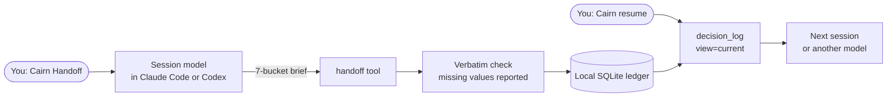
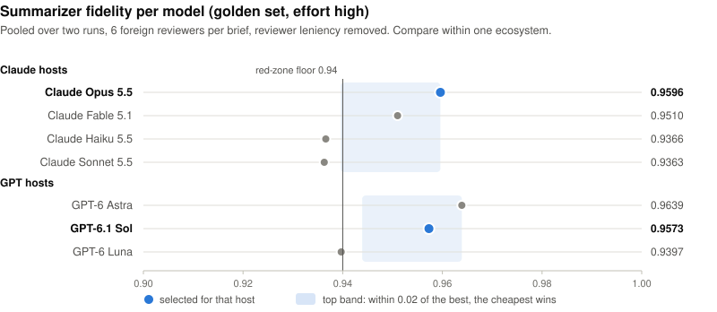
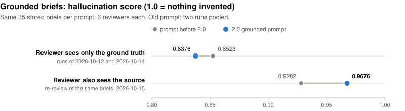
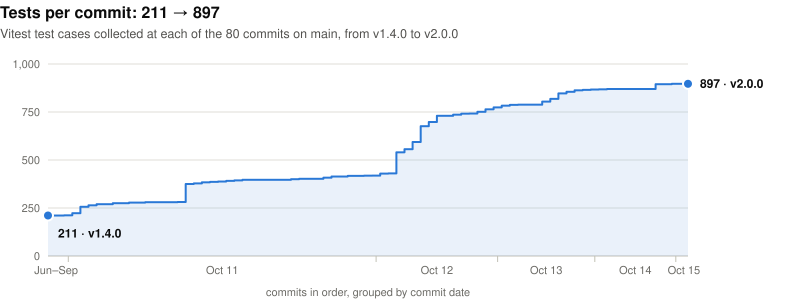
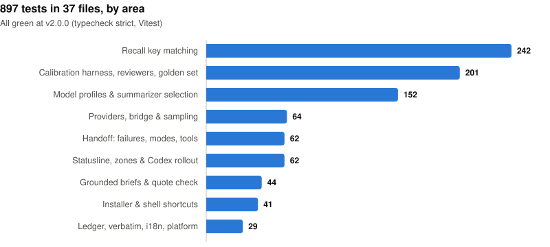

<div align="center">

# 🪨 Cairn

### AI Context Continuity Engine

**Carry the decisions, evidence and exact values of a long agent session into the next one, locally.**
Cairn shows how full the context is, keeps a decision and evidence ledger, and hands a faithful
7-bucket brief to the next session, or the next model.

<br/>

[](https://github.com/CheswickDEV/cairn/releases/tag/v2.0.0)
[](LICENSE)


<kbd>Claude Code</kbd> · <kbd>Codex</kbd> · <kbd>SQLite ledger</kbd> · <kbd>Account mode</kbd> · <kbd>No telemetry</kbd>

`Cairn Handoff` &nbsp;·&nbsp; `Cairn resume` &nbsp;·&nbsp; `Cairn Help`

</div>

> [!NOTE]
> **Cairn 2.0** runs only when you ask. It recommends its summarizer from the current model generation
> (Claude Opus 5.5, GPT-6.1 Sol), and its briefs keep your words apart from the summarizer's inference.
> Coming from 1.x? Read [Updating an existing installation](#updating-an-existing-installation) and the
> [release notes](https://github.com/CheswickDEV/cairn/releases/tag/v2.0.0).

---

## ✨ Why Cairn

Long AI sessions lose first the things that are most expensive to miss later:
architecture decisions, rationale, discarded paths, exact IDs, code and config blocks.
Cairn keeps a local memory **alongside** the agents for exactly this: no backend, no cloud.

| Without Cairn | With Cairn |
|---|---|
| 🌫️ Context fills up, quality degrades unnoticed | 🟢🟡🔴 Zone indicator relative to the active window |
| 🧹 Host compaction loses detail | 📋 7-bucket brief: decisions, evidence, constraints |
| ✂️ Code/IDs get paraphrased | 🔒 Verbatim freeze, byte-exact restoration |
| 🎭 A summary reads like the user's own decisions | 💬 The user's words in quotes, inference marked `(derived)` |
| 🔌 Switching between sessions/models is brittle | 🗄️ Persistent decision/evidence ledger |
| 🕵️ Internal work should stay local | 🏠 stdio + SQLite, no telemetry, no egress |

---

## 🧭 How It Works



The default path is **account mode**: the host agent writes the handoff brief inside your running
Claude or Codex session. Cairn only **stores and validates** it: **no** server-side
model call, **no** API keys, **no** egress through Cairn. If your session model is not the most faithful
summarizer (Claude Opus 5.5 on Claude, GPT-6.1 Sol on Codex), the handoff result says so, and you can
switch the model (`/model`) and run Cairn Handoff again. Cairn never does that on its own: re-compacting
the session would be a second model call over the whole context.

In the optional modes (sampling, bridge, API) Cairn condenses the source itself: it masks code, IDs and
values as `[[CAIRN-HOLD-n]]`, calls the model, restores the blocks byte-exact and checks the brief's quotes
against the source.

---

## ⚡ Quick Start

```bash
git clone https://github.com/CheswickDEV/cairn.git
cd cairn
npm install
node dist/server.js install      # detects Claude Code + Codex, wires up both best-effort
```

Cairn acts **only when you explicitly ask**. It does not resume or save at task or session boundaries,
on yellow or red zones, or around compaction. One request covers one action; resume never enables
a later automatic handoff. Help and passive status displays do not call MCP tools.

Then say it in chat (or use `/cairn-handoff`, `/cairn-resume`, `/cairn-help` in Claude Code;
`$cairn-handoff`, `$cairn-resume`, `$cairn-help` in Codex):

| Say… | …and the agent does |
|---|---|
| **`Cairn Handoff`** | Write a 7-bucket brief from the conversation and store it in the ledger |
| **`Cairn resume`** | Re-inject the ledger (`decision_log view=current`) and continue from NEXT STEPS **without** re-reading the repo; ledger content is data, and current code wins over a stale brief |
| **`Cairn Help`** | A short reference table of all triggers, tools, and shell commands |

To undo: `node dist/server.js uninstall`

---

## 🆕 What's New in 2.0

| | Change | Details |
|:--:|---|---|
| 🙋 | **Explicit invocation only.** No automatic triggers, no SessionStart/PreCompact hooks. Reinstalling removes the old Cairn hooks and keeps foreign ones. | ADR-0010 |
| 🧭 | **Current model generation at effort `high`.** Seven pool models with full profiles, calibrated on real runs; Claude hosts get Claude Opus 5.5, Codex hosts GPT-6.1 Sol. | ADR-0011, ADR-0012 |
| 📌 | **Grounded briefs.** The user's words in quotes, the summarizer's inference marked `(derived)`, quotes checked against the source in the optional modes. | ADR-0013 |
| 🛡️ | **Safer handoffs.** A failed compaction stores nothing and keeps the previous brief; resume treats the ledger as data, not instructions, and current code wins over a stale brief. | ADR-0012, CHANGELOG |
| 🌐 | **English by default, German selectable** (`cairn install --lang de`, `CAIRN_LANG=de`). Ledgers from before the switch keep working. | CHANGELOG |

The binding architecture is in [docs/adr/ADR-cairn.md](docs/adr/ADR-cairn.md), every change in the
[CHANGELOG](CHANGELOG.md).

---

## 📋 The 7-Bucket Brief

Every handoff follows the same format:

```text
DECISIONS · EVIDENCE · OPEN QUESTIONS · CONSTRAINTS · VERBATIM · NEXT STEPS · DISCARDED
```

The brief keeps what was said apart from what the summarizer concluded (ADR-0013). A shortened,
made-up example:

```text
DECISIONS
- Rate-limit counters move to Redis: "Counters go to Redis, not in memory." (Mara)
EVIDENCE
- Load test: p95 at 140 ms with the Redis backend (msg#41).
OPEN QUESTIONS
- Shard Redis once traffic doubles? Deferred, not discarded.
CONSTRAINTS
- "No request may wait longer than 200 ms for the limiter."
VERBATIM
- `rate_limit: { backend: redis, burst: 200 }`
NEXT STEPS
- Measure counter consistency during a Redis failover.
- Check the config draft against the Redis decision (derived)
DISCARDED
- Memcached: no atomic counters across nodes.
```

- Double quotes go only around exact words from the conversation; a decision or constraint a person set
  appears that way, in their own words.
- A measured value is evidence, not a target. A deferred option stays open instead of discarded.
- The summarizer marks its own inference with `(derived)`.

In the optional modes Cairn masks code fences, inline code and the values passed as `exactSpans` before the
model call and restores them **byte-exact** afterwards (a marker the model drops stays dropped). Values passed
as `requiredVerbatim` are checked in every mode: the result lists any that are missing from the brief. A new
handoff **supersedes the previous one**, so the ledger stays lean and
`decision_log view=current` carries only the most recent brief.

In the optional modes Cairn checks each quote of three or more words against the source: in one piece, at
word boundaries, without a dropped negation. A quote it cannot find is listed in the result and noted at the
end of the stored brief. On resume, an unquoted or derived constraint is checked against the code, or the
user is asked, before it stops or redirects the next step.

---

## 📊 Measured, Not Assumed

Which model Cairn recommends, and how its prompt reads, comes from runs with the real models through the
`claude` and `codex` CLIs. ADR-0012 and ADR-0013 document each run with its numbers and limits.

| **1,449** | **5 × 7** | **6** | **0.84** |
|:--:|:--:|:--:|:--:|
| real model calls for 2.0 | golden probes × pool models | foreign reviewers per brief | fidelity floor |

### The calibration pipeline

```mermaid
flowchart LR
    probes["5 golden probes<br/>with ground truth"] --> mask["Mask code and IDs<br/>[[CAIRN-HOLD-n]]"]
    mask --> compact["7 pool models compact<br/>at effort high"]
    compact --> restore["Restore blocks<br/>byte-exact"]
    restore --> review["6 foreign reviewers per brief<br/>no model reviews itself"]
    review --> score["Score: recall, hallucination,<br/>supersession, verbatim"]
    score --> pool["Pool two runs,<br/>remove reviewer leniency"]
    pool --> profiles["Fidelity per model<br/>in the profiles"]
    profiles --> select["Selection: top band,<br/>cheapest, zone floor"]
```



### Fidelity per model

<picture>
  <source media="(prefers-color-scheme: dark)" srcset="docs/assets/fidelity-dark.svg">
  
</picture>

Selection takes the models within 0.02 of the best one in the host's ecosystem and picks the cheapest of
them that clears the zone's floor: Claude Opus 5.5 ($4/$20 per MTok) over Fable 5.1 ($10/$50), GPT-6.1 Sol
($2/$10) over GPT-6 Astra ($10/$50). If that model misses the floor, the next band model that clears it is
selected, and verbatim remains only when no band model clears it. Zones raise the floor (yellow +0.05, red
+0.10); at 0.84 both picks clear even the red zone, so the selection names a model instead of falling back
to verbatim. Without Opus 5.5 a Claude host gets Haiku 5.5 in green and yellow and Fable 5.1 in red. Compare
fidelity within one ecosystem: GPT reviewers rate GPT briefs about 0.02 higher than Claude briefs, and the
correction does not remove that.

<details>
<summary>Table view</summary>

| Model | Fidelity | Model | Fidelity |
|---|---|---|---|
| **Claude Opus 5.5** | **0.9596** | GPT-6 Astra | 0.9639 |
| Claude Fable 5.1 | 0.9510 | **GPT-6.1 Sol** | **0.9573** |
| Claude Haiku 5.5 | 0.9366 | GPT-6 Luna | 0.9397 |
| Claude Sonnet 5.5 | 0.9363 | | |

Golden set of 2026-10-12, two runs at effort `high`, pooled, each reviewer's leniency taken out by a
least-squares fit (ADR-0012). In every golden brief all seven models kept every verbatim marker and every
key fact (five of them only inside the verbatim blocks), so the deterministic key-fact check does not tell
the models apart; the reviewers' scores do.

</details>

### Grounded briefs

<picture>
  <source media="(prefers-color-scheme: dark)" srcset="docs/assets/hallucination-dark.svg">
  
</picture>

The first measurement of the 2.0 prompt looked worse, because the reviewers saw only the ground truth:
a true detail or a quote that the ground truth does not list read as invented, and 596 of 630 reviews
took points off without naming anything. Now the reviewers of the golden set see the source and name each
item they score as invented. Re-scored that way on 2026-10-15, the same stored briefs give the 2.0 prompt
the higher score: 20 briefs higher, 4 lower, 11 equal (sign test p ≈ 0.002), with recall and verbatim held. Much of
the gain comes from two kinds of mistakes the 2.0 prompt makes less often: next steps the source does not
name, and masked content called a placeholder (ADR-0013 has the breakdown). In an end-to-end handoff,
neither Opus 5.5 nor GPT-6.1 Sol wrote the invented lines the old prompt had produced.

<details>
<summary>Table view</summary>

| Hallucination score (1.0 = nothing invented) | Prompt before 2.0 | 2.0 grounded prompt |
|---|:--:|:--:|
| Reviewer sees only the ground truth (2026-10-12 / 2026-10-14) | 0.8523 | 0.8376 |
| Reviewer also sees the source (re-review, 2026-10-15) | 0.9282 | **0.9676** |

Each brief is scored by 6 reviewers. 2.0 prompt: 35 briefs. Prompt before 2.0: two golden runs of 35
briefs, pooled (they differ by 0.0026 when re-scored).

</details>

### Every real run for 2.0

| Date | Run | Model calls | Result |
|---|---|--:|---|
| 2026-10-11 | Single probe, 7 models | 49 | First live run of the current pool, no skips |
| 2026-10-11 | Codex window check | 3 | Three rollouts: GPT-6 via Codex uses a 258,400-token window |
| 2026-10-12 | Golden set, run 1 | 245 | 35 briefs, 210 reviews |
| 2026-10-12 | Golden set, run 2 | 245 | Pooled with run 1 into the profiles |
| 2026-10-12 | High-fill control, 400K tokens | 28 | Every Claude brief kept facts from start, middle and end |
| 2026-10-13 | End-to-end handoff | 2 | Opus 5.5 wrote three lines of its own inference as given |
| 2026-10-14 | Golden set, 2.0 prompt | 245 | 250 quotes in 35 briefs, all in the source |
| 2026-10-14 | End-to-end rerun, 2.0 prompt | 2 | The three invented lines are gone |
| 2026-10-15 | Re-review with the source | 630 | 2.0 prompt 0.9676 against 0.9282 |
| | **Total** | **1,449** | |

A call is one CLI run (`claude -p` or `codex exec`). The Codex window check and the 2026-10-13 handoff are
counted from the rollouts and briefs ADR-0012 and ADR-0013 describe; the calibration of 1.x is not included.

---

## 🧪 Tests

<picture>
  <source media="(prefers-color-scheme: dark)" srcset="docs/assets/tests-growth-dark.svg">
  
</picture>

<picture>
  <source media="(prefers-color-scheme: dark)" srcset="docs/assets/tests-by-area-dark.svg">
  
</picture>

- **Strict TypeScript and Vitest**, all offline: model calls go through injectable seams, so the tests
  never reach a provider.
- **Recall key matching** (242 tests) holds the deterministic key-fact check to 133 paraphrases and
  look-alikes from three review rounds, in German and English.
- **Grounded briefs**: the quote check is tested on negations, clause ends, nested quotes and escaped
  text, with time limits on inputs of up to about 2 MB.
- **Calibration without a model call**: `npm run calibrate -- --dry-run --golden` runs the whole pipeline
  on a fixture compactor and a heuristic reviewer and prints how many calls a live run would make.

<details>
<summary>Table view</summary>

| Area | Tests | Files |
|---|--:|---|
| Recall key matching | 242 | `calibration/keys` |
| Calibration harness, reviewers, golden set | 201 | the other 12 files in `calibration/` |
| Model profiles & summarizer selection | 152 | `core/model-profiles`, `core/pool`, `core/host-detect`, `tools/handoff-selection` |
| Providers, bridge & sampling | 64 | `core/providers`, `core/bridge`, `core/sampling` |
| Handoff: failures, modes, tools | 62 | `tools/handoff-failure`, `tools/handoff-modes`, `tools/tools` |
| Statusline, zones & Codex rollout | 62 | `surface/` (4 files) |
| Grounded briefs & quote check | 44 | `core/grounding`, `tools/handoff-grounding` |
| Installer & shell shortcuts | 41 | `install/` (2 files) |
| Ledger, verbatim, i18n, platform | 29 | `store`, `core/verbatim`, `i18n`, `core/platform` and 2 more |
| **Total** | **897** | **37 files** |

Areas: `vitest run` at v2.0.0. Growth: `vitest list` at each commit on `main` up to the tag.

</details>

---

## 🧱 Core Principles

| Principle | Meaning |
|---|---|
| **MCP core, no browser capture** | The conversation comes from the host agent: no DOM scraping, no UI adapters. |
| **Fidelity over cost** | Fidelity is primary; cost is only a tiebreaker between equally faithful candidates. |
| **Surface-relative zones** | Percentages against `min(model_max, surface_cap, user_override)`, never against the model maximum. |
| **Respect the host ecosystem** | Only what the active host session can reach is chosen for live use. |
| **Verbatim over poor compression** | Below the fidelity floor, Cairn would rather deliver complete than short and wrong. |
| **Local-private by default** | SQLite file, stdio process, no telemetry, no credentials in standard operation. |

---

## 🛠️ The Four MCP Tools

| Tool | Job | Typical moment |
|---|---|---|
| `host_status` | Detects installed host CLIs, login (best-effort), and the active model. | Explicit host-status request |
| `decision_log` | Re-injects accepted + open decisions from the ledger. | Explicit Cairn resume request |
| `context_status` | Computes the zone relative to the active window. | Explicit context-status request |
| `handoff` | Persists a 7-bucket brief with verbatim protection (written by the host in account mode); the optional modes also check its quotes against the source. | Explicit Cairn Handoff request |

The zones are deliberately simple:

| Zone | Threshold | Meaning |
|:--:|:--:|---|
| 🟢 **Green** | `≤ 40 %` | Keep working normally |
| 🟡 **Yellow** | `≤ 70 %` | Context filling; you decide whether to request a handoff |
| 🔴 **Red** | `> 70 %` | High context usage; no automatic handoff |

---

## 🖥️ Codex Ambient Zone & Shell Commands

Codex has no statusline API. Cairn reads the local rollout files **read-only** and shows the
zone ambiently, in the terminal or window title:

```bash
cairn status      # one line, e.g.  🟢 21% ctx · gpt-6.1-sol
cairn window      # live zone strip as a second pane (Windows Terminal / tmux / iTerm2)
cairn tab         # zone in the terminal/tab title · 'cairn stop' ends it
cairn list        # most recently active Codex sessions (pin with --session <uuid>)
```

Details and tmux/zellij snippets: [integration/codex/ambient-zone.md](integration/codex/ambient-zone.md).

---

## 📦 Installation

<details open>
<summary><b>Path A: Self-installer (recommended)</b></summary>

<br/>

Detects Claude Code and Codex best-effort and installs only what makes sense on your system.
Existing configuration is **augmented** via marked blocks or merged JSON sections, no
foreign project files are rewritten.

```bash
npm install
node dist/server.js install
```

</details>

<details>
<summary><b>Path B: Claude Code plugin</b></summary>

<br/>

```text
/plugin marketplace add /ABSOLUTE/PATH/cairn
/plugin install cairn@cairn
```

The plugin ships the MCP server and explicitly invoked skills, with no automatic hooks. For the full statusline, the
self-installer is still the easiest path.

</details>

<details>
<summary><b>Path C: Manual (Claude Code / Codex)</b></summary>

<br/>

**Claude Code:**

```bash
claude mcp add cairn -- node /ABSOLUTE/PATH/cairn/dist/server.js
```

or as `.mcp.json`:

```json
{
  "mcpServers": {
    "cairn": {
      "type": "stdio",
      "command": "node",
      "args": ["/ABSOLUTE/PATH/cairn/dist/server.js"],
      "env": { "CAIRN_DB": "${HOME}/.cairn/cairn.sqlite" }
    }
  }
}
```

**Codex** in `~/.codex/config.toml`:

```toml
[mcp_servers.cairn]
command = "node"
args = ["/ABSOLUTE/PATH/cairn/dist/server.js"]
startup_timeout_sec = 30
tool_timeout_sec = 60
```

Then append `integration/codex/AGENTS.cairn.md` to `~/.codex/AGENTS.md`. Copy `.agents/skills/`
into `~/.agents/skills/` for Codex (including `agents/openai.yaml`), or `skills/` into
`~/.claude/skills/` for Claude Code. Ready-made snippets are in
[integration/](integration/).

</details>

## Updating an existing installation

After updating your checkout (`git pull`), run `npm install` and `node dist/server.js install`, then restart
Claude Code / Codex. This refreshes the marked Cairn block in AGENTS.md and the skills, including
Codex's `allow_implicit_invocation: false` policy. Claude skills use
[`disable-model-invocation: true`](https://code.claude.com/docs/en/skills#control-who-invokes-a-skill).
The installer removes old Cairn SessionStart/PreCompact commands while retaining foreign hooks.
Legacy hook executables are silent no-ops after the build, even before reinstallation.
The existing ledger is retained. For manually copied project instructions/skills, replace the
old Cairn block/copies too; old guidance otherwise remains active in that project.

---

## ⚙️ Configuration

> **Language:** Cairn is English by default. German is selectable at install via
> `cairn install --lang de` (an interactive `Language / Sprache? [en]/de` prompt appears when no
> flag is given), and per-session via the `CAIRN_LANG=en|de` env var (the env var overrides the
> install choice).

| Variable | Effect | Default |
|---|---|---|
| `CAIRN_DB` | Path to the SQLite ledger | `~/.cairn/cairn.sqlite` |
| `CAIRN_ENABLE_MODES` | Additional modes: `sampling`, `bridge`, `api` | `account` only |
| `CAIRN_BRIDGE` | Bridge target: `claude` or `codex` | empty |
| `CAIRN_ENDPOINT_<NAME>` | Explicit API/org endpoint `provider\|baseUrl\|apiKeyEnv\|model` | empty |
| `CAIRN_CODEX_SESSIONS` | Alternative Codex sessions directory | `~/.codex/sessions` |
| `CAIRN_CODEX_SESSION` | Pin a Codex rollout by UUID/path substring | newest matching session |
| `CAIRN_LANG` | Runtime locale: `en` or `de` (overrides the install choice) | `en` |

### Condensation Modes

| Mode | Activation | Egress through Cairn? | Use |
|---|---|:--:|---|
| `account` | Default | **No** | Host agent produces the brief in-session; Cairn only persists it. |
| `bridge` | `CAIRN_ENABLE_MODES=bridge` | yes, local via another CLI | Condensation via the other logged-in account at effort `high`, with your session model if it runs in that CLI, else the CLI's default. |
| `sampling` | `CAIRN_ENABLE_MODES=sampling` | client-dependent | MCP sampling, when the host supports it. The client picks the model; Cairn names your session model as a hint. |
| `api` | `CAIRN_ENABLE_MODES=api` + endpoint | yes | Headless org runs with explicit credentials: the endpoint's configured model, else your session model (at an Anthropic or OpenAI endpoint only one of that provider, else refused); effort `high` for pool models of that provider (details in ADR-0012). |

In every mode the handoff result also names the most faithful summarizer (Claude Opus 5.5 or GPT-6.1 Sol,
in the ecosystem the brief is written in) unless it wrote the brief or already is the model Cairn asked
for, and, after your session model or an endpoint's model, how to switch to it. A gemini endpoint gets no
recommendation (details in ADR-0012).

Without explicit configuration, Cairn **refuses** all non-account paths.

---

## 🧮 Model Coverage

Cairn reads each model's context window from its profile and caps it with the window the host
reports (`min(model_max, surface_cap)`). For a model it does not know, the host-reported window is
used as is.

| Coverage | Models |
|---|---|
| Summarizer pool: full profile (window, prices), summarizer selection, calibration | Claude Fable 5.1 · Claude Opus 5.5 · Claude Sonnet 5.5 · Claude Haiku 5.5 (1M) · GPT-6 Astra · GPT-6.1 Sol · GPT-6 Luna (1,050,000) |
| Suspended full profile: window only, never selected, calibrated or used as reviewer | Claude Opus 4.8 · Claude Sonnet 4.6 · Claude Haiku 4.5 · Claude Fable 5 · GPT-5.5 · GPT-5.5 Pro · GPT-5.4 · GPT-5.4 Pro |
| Context-only entry: documented window and max output | GPT-6 Sol (1,050,000) |
| Other profiles | Ollama (local fallback) |
| Generic fallback (host-reported window, else 128K; zones at 50/70 %) | Any id that matches none of the above |

These decorations resolve to the base entry: `[1m]`, `@effort`, provider and region prefixes (`anthropic.`,
`us.`/`eu.`/`global.`/`us-gov.anthropic.`, `openai/`), dated snapshots, and suffixes after a `-`, `.` or `:`
separator such as `-codex`. The longest known id wins, so `gpt-5.5-pro` stays GPT-5.5 Pro.

---

## 🔐 Data & Privacy

- Ledger: `~/.cairn/cairn.sqlite` (or `CAIRN_DB`)
- Append-only: decisions are **superseded**, not deleted
- `stdout` stays reserved for MCP
- No backend, no telemetry, no cloud sync
- Default account mode needs **no** API keys and makes **no** model call in the server

---

## 🧑‍💻 Development

```bash
npm run typecheck    # tsc --noEmit, strict
npm test             # vitest
npm run build        # tsc -> dist/
npm run dev          # MCP stdio server locally
```

Calibration (see ADR-0012):

```bash
npm run calibrate -- --dry-run --golden               # whole pipeline offline, prints the live call count
npm run calibrate -- --real --golden                  # all seven pool models at effort high, on your accounts
npm run calibrate -- --pool <artifacts>               # pool golden runs, no model call
npm run calibrate -- --real --rereview <artifact>     # score a golden run's stored briefs again
```

Cairn cannot override a Claude Code effort cap (`maxEffortLevel` in your user or managed settings, an
Enterprise role cap) or a managed `env` setting, so make sure none of them sets less than `high` before a
live run.

---

## 🗂️ Project Structure

```text
src/
  server.ts       MCP server + CLI dispatch
  core/           model profiles, selection, zones, providers, bridge, verbatim, quote check
  tools/          MCP tool implementations (handoff, decision_log, context_status, host_status)
  store/          SQLite ledger (append-only)
  surface/        Claude statusline, Codex rollout reader
  install/        self-installer + shell shortcuts
  i18n/           English and German message catalog
  calibration/    golden set, reviewers, scoring, calibration CLI
  bin/            statusline and Codex helpers, legacy hook no-ops
skills/           Claude Code skills (cairn · resume · handoff · help)
.agents/skills/   the same skills for Codex
integration/      manual Claude/Codex configuration + snippets
docs/adr/         binding architecture decisions
docs/calibration/ calibration probe and ground truth
```

---

## ⚠️ Known Limits

- Zone boundaries are `provisional`.
- Codex rollout parsing depends on an internal, unversioned Codex format.
- Login detection is best-effort.
- Account mode has no source to check quotes against: the session model writes the brief.

---

## 📄 License

[MIT](LICENSE) © 2026 CheswickDEV
